Renewable Energy Generator

Senior Design / Capstone Midterm Design Document

Team Members:

Miles Bolden, Bryce Coln, Justin Egwuatu, and Tobin McGee

Instructor Name: Dr. Storm Johnson

Project Supervisor: Dr. Storm Johnson

Customer: ECE Department – College of Engineering

Institution: Tennessee Tech University

Date: September 28th, 2026

Introduction:

Access to reliable electrical power is important in emergency situations, outdoor environments, and remote locations where utility power is unavailable. Portable generators provide solutions to this problem, but many commercially available systems are very expensive. The objective for team 11's project is to develop an affordable, durable, efficient, and portable renewable energy generator. It will be capable of providing power from a rechargeable battery. Which will be primarily charged through photoelectric solar power or secondarily through standard US wall outlet. The system will deliver uninterrupted AC and DC power automatically from the renewable source or internal battery.

This midterm design document will:

- Detail the problem that this project shall solve.
- List the specifications and constraints imposed by relevant safety standards and the scope of the problem.
- Research current solutions to the formulated problem.
- Perform a comparative analysis of potential solutions inspired by components of existing solutions.
- Describe the high-level solution and how it solves the fully formulated problem.
- Give detailed explanations of each subsystem of the solution.
- Describe measures of success for the project.
- Detail the specific implications of the solution for a customer
- Explore Broader Implications, Ethics, and Responsibilities as Engineers
- List references
- List Statement of Contributions

Defining the Problem:

The problem Team 11 shall solve is creating a cost-effective, portable electric generator that effectively charges from a variety of sources, namely renewable energy. Our target customer is any entity in need of an electric generator that can be transported entirely by a single person without much effort. A crucial part of the project is for it to have the ability to power a broad selection of devices in remote locations with renewable energy, primarily solar power. Some specific use case examples are disaster aid and relief, technology demonstrations for outdoor environments, and dispersed camping.

Team 11 strongly believes that many of the existing solar powered generators are not cost effective and that our project will match performance and safety for a lower cost.  
 Background of the Problem:

Generators throughout the years have been a staple in portable power, being able to provide power to those off the grid. Combustion engine generators require fuel to operate which complicates transport and handling for a single person. Combustion generators also create constant noise and air pollution while in use. As a result, limiting the product to solely outdoor usage. Renewable energy generators aim to diminish these issues by removing the need for consumable fuel which improves air quality and has much quieter operation. Allowing stored energy to be used indoors without long power cables. Targeting single person portability, a comparable combustion generator such as the WEN 2000 Watt Inverter creates noise pollution of around 53dB and requires transportation of liquid fuel to have sustained operation over multiple days. \[1\] A comparable renewable energy generator system such as the Jackery Solar Generator 2000 v2 costs over \$1000, making it non-viable for a considerable portion of consumers. \[2\] Transporting solar panels is significantly safer than transporting liquid fuel.

Specifications to be met by the project:

The generator shall meet the following requirements to operate reliably and safely:

1. Enclosure Frame System: The system should provide structural support, physical protection, and environmental resistance of internal electrical components.
   - Wheels: The central unit when sat down should be mobile over indoor flooring, pavement, and lawns by using wheels.
   - Handle: The system should have a handle for the operator to comfortable lift or steer the central unit on the wheels.
   - Electrical Protection: The enclosure should be made to maximize electrical protection of the high and low power systems contained within.
   - Water Resistance: The enclosure should provide enough water resistance such that the device is not damaged nor becomes hazard due to light rainfall.
2. Power Supply System: The system shall provide output power from the generator through electrical discharge. It should monitor performance and convert DC to AC power for the 120 AC output.
   - Battery: The device shall utilize suitable battery chemistry to charge and discharge.
   - Battery Management System: The project shall feature a device to monitor performance of the battery and protect the battery from unprecedented fluctuations in charge and discharge.
   - Rectifier: The device shall utilize a rectifier to be able to charge the battery from 120 V AC power.
   - Inverter: The device shall utilize energy stored in the battery or sourced by the solar panel to convert DC to AC power.
   - Fuses: The device shall protect the power system from faults due to unexpected spikes in current
   - Outputs: The device shall output DC and AC power though common receptacles found in the United States.
   - Output goal: The device shall be able to safely deliver a minimum of 200 W across all loads simultaneously for a minimum of 2 hours.
   - Uninterrupted output: The device should seamlessly provide power to devices without user intervention or noticeable interruption in cases where the power source changes between solar and battery.
3. Embedded System:
   - PCB: The system shall feature a custom designed PCB to handle the display, the physical controls, house the microcontroller, and any other integrated circuit components that are determined necessary during detailed design.
   - Display: The system shall graphically display information on the exterior of the device. This information shall include the voltage of the battery, the voltage of the DC output, and any other information that may be deemed important later.
   - The embedded system will handle power negotiation for USB type C power delivery and USB type A charging.
   - The embedded system will control and contain a variable DC power supply that accepts 4mm banana plugs.
4. Solar Charging System: The system will provide power to the battery and to the load so that it can either charge the battery or supply power directly to the load if desired.
   - Solar Charge Controller: The charge controller shall manage the power delivered by the solar panels and determine if the power goes to the battery to charge, to the load, or stay in place if it is unneeded.
   - Solar Panel: The solar panels should provide power to either the battery or the load in order to directly power the connections or to charge the battery for later use.
   - Separate unit: The solar panels should be a portable, separate unit from the central unit. Removable cables will be required to connect units. The weight of the solar unit is not considered part of the central unit but should have the same portability considerations.

The specifications were designed based on collaboration with stakeholders' intended function of the device.

Constraints placed on the project:

- Regulatory and Compliance Constraints:
  - This device shall comply with FCC Title 47 Part 15. Such that any high frequency part of the device shall not create harmful interference. The device must accept any harmful interference. \[18\]
- Electrical and Safety Constraints: Prevention of electrical, physical, and thermal hazards during operation or storage
  - Shall be properly grounded and bonded to prevent electrical shock in accordance with NFPA 70 article 250.4 (A) \[8\]
  - Flexible cords or cables shall follow rated values referring to wire gauge and insulators as listed in table 400.5(A) of NFPA article 400 \[8\]
  - Enclosure shall provide environmental resistance and structural protection equivalent to a minimum NEMA 3R or NEMA 4 rating per NEC Table 110.28 to ensure operational durability under sunny, rainy, and windy conditions. \[8\]
  - In compliance with NEC section 314.15 the enclosure's perimeter seals and thermal cooling paths shall exclude all water ingress. \[9\]
  - Enclosure shall undergo and pass water-exposure testing under IEC 6000068-2-18 verifying that direct spray mist yields no internal moisture accumulation
  - The charge controller and inverter shall maintain proper shock protection and overcurrent charge safety in accordance with UL 1741. \[13\]
- Transportation and Ergonomic Constraints
  - Each unit shall weigh no more than 50 lbs. to be lifted by a single individual. The NIOSH defines 51 lbs. to be the maximum weight an adult should lift under ideal conditions. \[17\]
  - The project shall not present an undue risk to individuals during storage, transportation, nor operation.
- Embedded system Constraints:
  - Any USB Type C receptacles shall comply with the latest USB PD standard \[16\]
  - Any USB Type A receptacles shall comply with the latest standard that specifics type A dedicated power ports (DCP). \[18\]

**Survey of Existing Generator Solutions:**

There are several existing generator solutions from DIY builds to fully commercialized products of renewable portable generators. Two particularly informative examples for commercially available solutions are the WEN 56203i 2000-Watt Inverter Generator and the Jackery Solar Generator 2000 v2. Although, these products represent different approaches when it comes to portable power generation. The WEN generator demonstrates conventional fossil fuel powered AC generation, while on the contrary, the Jackery system integrates battery storage, solar charging, and multi-mode power delivery. Team 11 shall use these existing products for useful ideas and design references when constructing the renewable energy generator.

**WEN 2000-Watt Generator**

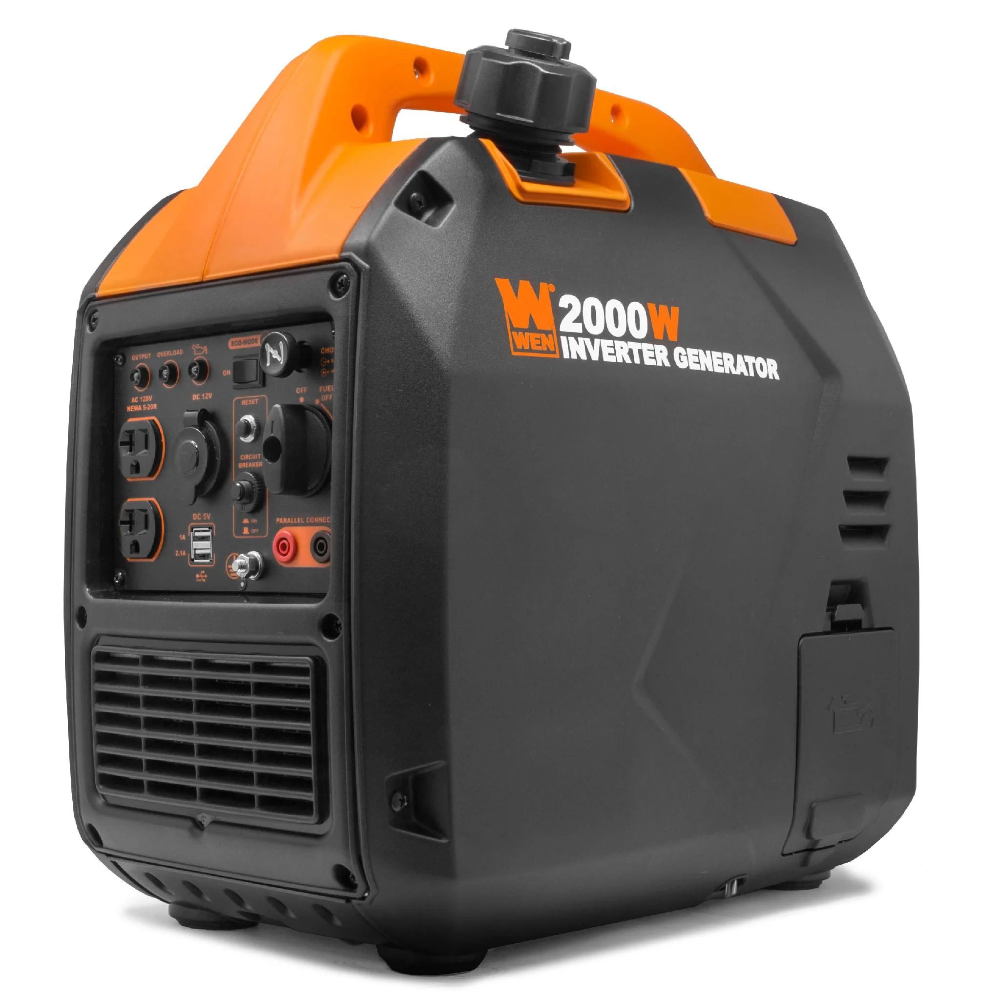

Figure WEN 2000-Watt Generator

Pros

- Affordability: Current manufacturer price is listed at \$499.99 which is under our cost budget at \$1000.
- Portability: Lightweight design makes it easy for portability for a single person. Approximately 39 lbs in total.
- Higher Power Output: Provides 1,700 W rated power and 2,000 W surge power which is substantially greater than our 200 W minimum requirement

Cons

- Engine Noise and Heat: Even though it is quiet still produces mechanical noise (51 dB at quarter load) and heat exhaust that we can avoid when designing.
- Non- Renewable: Uses gasoline-powered combustion engine rather than renewable energy. New fuel is required to be obtained for continual operation.
- No Rechargeable Battery: The generator does not provide a battery storage system.
- No Solar Charging: Does not use direct support for photoelectric charging.

**Jackery Solar Generator 2000 v2**

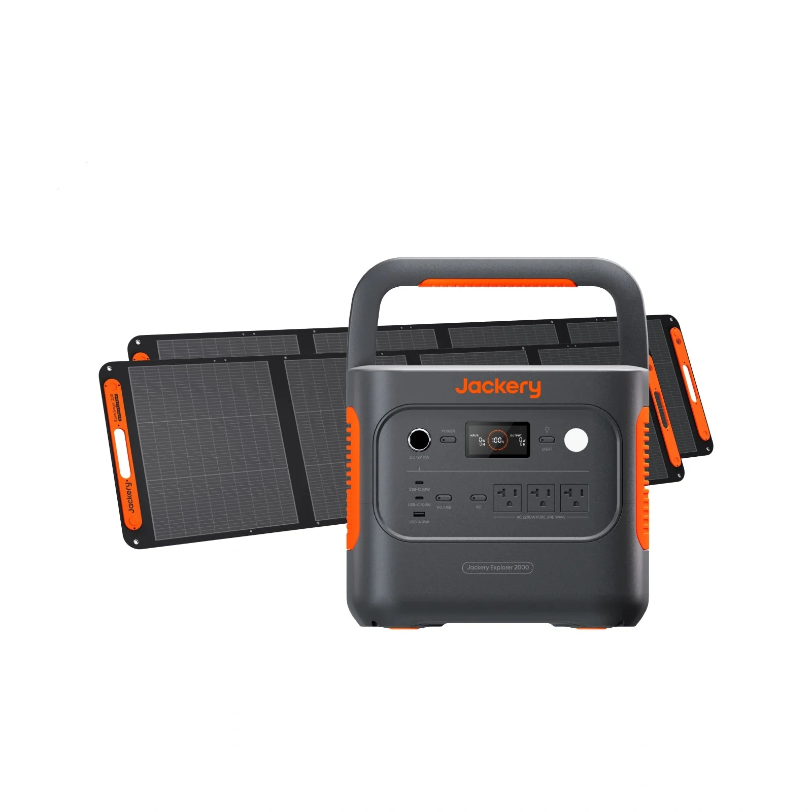

Pros

- Renewable: Compatible with photoelectric solar panels
- LiFePO4 Battery: Long life cycle with Jackery claiming 4,000 charge and discharge cycles maintaining at least 70% battery capacity.
- Large Battery Capacity: Contains 2,042 Wh. LiFeBO4 battery providing more power than our team's minimum requirement of 400 Wh. (200 W x 2 hr.)
- High AC output: Provides 2,200 W continuous and 4,400 W surge output.
- Quiet Operation: Way quieter than a combustion engine generator. Jackery claims less than 30 dB during operation.
- Solar charging: Supports up to 400 W of solar input
- BMS / Battery protection: Provides the battery management required for Team 11
- USB-A & USB-C Outputs: Provides multiple low-voltage output for electronics.
- DC output: Provides 12 V DC

Cons

- Expensive: Current manufacturer price is a bit above our cost budget of \$1000 listed at \$1,184.

This preliminary investigation shows that team 11 shall continue approaching this problem with a solution that utilizes renewable energy rather than using consumable fossil fuels. The transportation and storage concerns of liquid fuel fail to meet the criteria of transportation constraints for safety. Common untreated gasoline lasts less than a full year without additive stabilizers. With stabilizers and proper containers, the shelf life rises to between 1 and 2 years \[19\]. The LiFePO4 batteries commonly found in products like the Jackery Solar Generator 2000 v2 have shelf lives over a decade and lead acid batteries have shelf lives of 3 to 5 years \[20\]. The other concerns of note are operation noise and indoor use. Fuel powered generators cannot be used directly indoors and create unwanted noise during operation. Meanwhile an electric generator is safe for indoor use and is significantly quieter as seen in the comparison of the two generators above.

**Comparative Analysis of Potential Solutions:**

Renewable Energy Generators have recently emerged in the market of portable power. Many different solutions have been created by companies to tackle the project of portable power. This section aims to analyze the subsystems of renewable energy generators and determine what possible solutions exist for them. Team 11 has decided to explore these systems:

1. The battery chemistry
2. Enclosure design
3. Source of renewable energy
4. Devices needed to convert between AC and DC
5. Core embedded system and whether a custom PCB is suitable.

**Potential solutions for the battery selection:**

There are various chemical makeups of batteries, such as Lithium-Ion, Lithium-Ion Polymer, Nickel-Metal Hydride, and Lithium Iron Phosphate. The aforementioned battery types are typically used for portable applications. Comparable renewable energy generators such as Jackery Solar Generator \[2\], UDPOWER S1200 \[4\], and EcoFlow - Delta 3 Classic Portable Power Station \[5\] use Lithium Iron Phosphate batteries. Lithium Iron Phosphate batteries are frequently used for portable applications as they are "a type of lithium-ion battery that uses lithium iron phosphate as its cathode material. This chemistry is known for its exceptional safety, long cycle life, and stability, making it an ideal choice for applications where reliable and consistent power is crucial—like in portable power stations." \[6\]

Lithium Iron Phosphate ($LiFePO_4$) Battery \[14\]

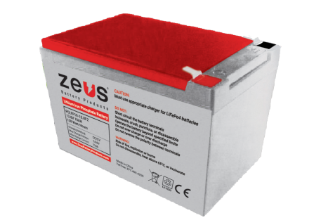

The battery chemistry consists of cells of $LiFePO_4$. The outer casing of the battery consists of ABS plastic. The nominal voltage for the battery is 12.8V, nominal capacity is 10AH and contains 128Wh of energy. Over voltage protection is within ±0.2V of 15.6V. Max charge current is 10A. Charge temperature runs within 0°C to 45°C, discharge temperature runs from -20°C to 60°C, and storage temperature runs from 0°C to 40°C. The battery weighs 3.53 lbs.

- Pros:
  - Lightweight, making it useful for portability
  - Built in battery management system
  - IP56 water and dust protection
  - \>2000 cycles at 25°C
  - <3% discharge per month
- Cons:
  - Higher priced than other batteries with similar voltage and current

Lead Acid Battery \[15\]

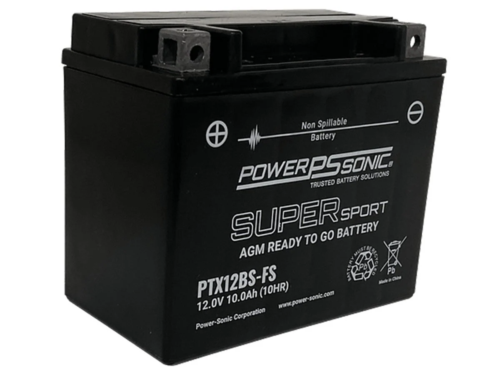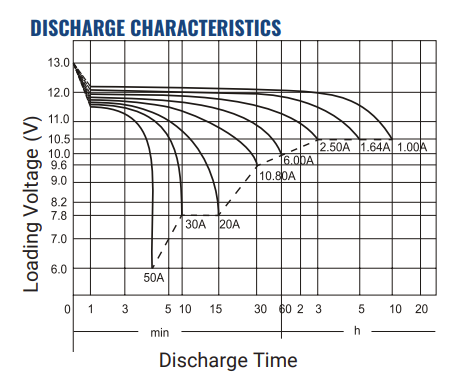

The chemistry of the battery consists of Lead Acid. The outer casing of the battery consists of ABS plastic. The nominal voltage of the battery is 12V and the nominal capacity is 10AH. The weight of the battery is 8.51 lbs. The effect of temperature on capacity is as follows: 104°F is 106%, 77°F is 100%, 32°F is 86%, and 5°F is 65%.

- Pros:
  - Significantly cheaper than Lithium based batteries
- Cons:
  - Temperature dependent efficiency
  - Heavier than alternative batteries with similar characteristics
  - 15-18 hour charging time
  - Discharge time is relatively fast under heavy load

Lithium Polymer

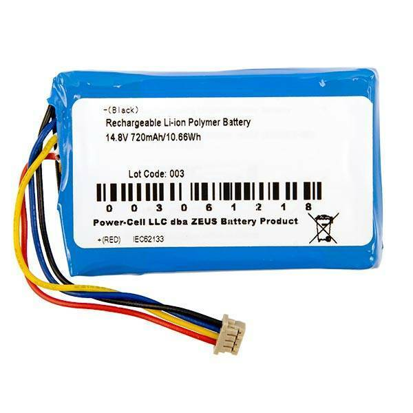

The battery is made up of a chemistry of Lithium-Ion polymer, which uses a gel like electrolyte. The battery contains a nominal capacity of 720mAh, a nominal voltage of 14.8V, and a charge voltage of 16.8V. Peak current is 1.5A and discharge cut off Voltage of 11V. Operating temperatures run from 0 to 45°C for charging and –20 to 60°C for discharging. The life cycle for the battery is ≥500 cycles at 0.2C discharge at room temperature.

- Pros:
  - Small footprint, takes up minimal space
  - Higher energy density than lithium iron phosphate and lead acid batteries
  - Stable operating temperatures
  - Integrated battery management system
- Cons:
  - ≥500 cycles, which is comparatively much less than $LiFePO_4$
  - The casing for the cells is not puncture resistant, which could result in leakage.

The comparison between the three battery types shows that Lithium Iron Phosphate would be the best battery for the renewable energy generator. Lithium Iron phosphate holds the highest number of cycles above both Lithium Polymer and Lead Acid batteries, meaning the longevity of the battery would outlast the others. Lithium iron phosphate batteries also hold the highest durability between the two as lead acid batteries contain acid that can be spilled or jostled, and lithium polymer batteries can be easily punctured, which makes both unfit for transportation. Lithium iron phosphate batteries are also lightweight, allowing for easy transportation over long distances.

**Potential Solutions for Enclosure design and features:**

The enclosure subsystem must protect the renewable energy generator's internal electrical components such as battery management system (BMS), battery, inverter, wiring, control electronics, and other internal components while allowing the unit to be transported by one person. The enclosure must support the required outdoor weather operating conditions including exposure to rain, wind, sunlight, and temperature changes. The subsystem must also accommodate wheels, a retractable luggage-style handle, ventilation, access to electrical outlets, and mounting points for the solar panels.

Three commercially available enclosure approaches were considered: a molded polymer equipment case with wheels and luggage handle, a polycarbonate + ABS weatherproof electrical enclosure, and a polypropylene dustproof enclosure. Team 11 is currently considering either 3D printing an enclosure or buying a prefabricated custom-built enclosure. These were evaluated into account according to specifications like environmental protection, structural portability and durability, weight, interior and exterior dimensions, cost, and compatibility with applicable engineering standards.

**Commercially Marketed Enclosures**

Platt 221609H Heavy-Duty Polyethylene Equipment Case \[16\]

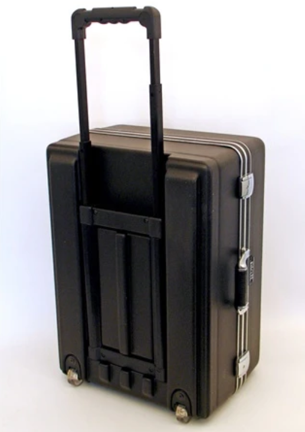

Pros:

- **Durability**: Heavy-duty exterior casing made of HMW polyethylene which absorbs physical shocks without shifting that pressure to internal components.
- **Transportation:** Includes wheels and telescoping handling for convenience.
- **Weight Limit:** Shipping weight is 18 lbs. which is within our 50 lb. spec limit.
- **Temperature Range:** Temperature threshold holds from a minimum of –50 °F to a maximum of 125 °F.

Cons:

- **Ratings:** Does NOT have official industry standard safety ratings
  - Not waterproof so cannot handle spray mist of water
- **Product Price:** Not within the acquired budget for enclosure subsystem.
  - (Range: \$351.75 - \$560.99)
- **Exterior Dimensions:** Not wide enough for solar panels to be mounted on the sides.
  - (Dimensions: L: 23 in W: 18 in H: 12 in)

Altelix 17x14x6 Vented NEMA Outdoor Enclosure \[17\]

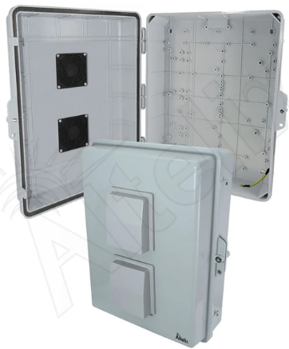

Pros:

- **Ratings:** NEMA 250 type 3R, 3RX / IP24 rated
  - Built for outdoor use to protect against rain and snow resistance.
  - Highly cost-effective with ventilation slots to cool internal component temps
  - Provides spray mist defense against water from any direction
  - Adds superior protection against salt water and chemical corrosive chemicals
- **Durability:** Heavy duty enclosure made of ABS thermoplastic + UV-resistant Polycarbonate weatherproof material
- Vented Enclosure:
- **Mounting Plate:** Includes mounting plate without the need for drilling.

Cons:

- **Ratings:** NEMA 250 type 3R, 3RX / IP24 rated
  - Not water submersion-proof
  - Due to ventilation, it cannot block out windblown dust
  - Does not provide airtight seals for explosive environments
- **Product price:** Not within the allocated budget for enclosure subsystem
  - (Best price listed at \$153.41)
  - Wheels not included
- **Exterior Dimensions:** Not wide enough to attach the solar panels on the side
  - (Dimensions – L: 17 in W: 14 in H: 6 in)
- **Transportation:** Does not include built-in wheels or retractable luggage-style extension handle.

Apache 5800 Weatherproof Protective Rolling Carry-On Case, X-Large \[18\]

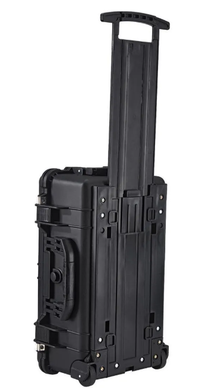

Pros:

- **Ratings:** IP65 rated
  - Completely dustproof and can withstand low-pressure water mist spray.
- **Durability:** Heavy-duty enclosure made of polypropylene material
  - Outer enclosure shell can handle heavy impact without damaging internal components.
- **Product Price:** Within allocated budget for enclosure system
  - (Price listed at \$89.99)
- **Transportation:** Includes built-in wheels and a retractable luggage-style extension handle.

Cons

- **Weight:** The case weighs roughly 15.5 lbs. completely empty taking up a little over 30% of our weight leaving us with 34.5 lbs. of weight distribution to fit the LiFePO${}_4^{}$ battery, inverter, wiring, and other internal electrical components
- **Temperature Range:** The temperature threshold is between a minimum of 0°F to a maximum of 180°F
  - The outer polypropylene shell acts as an insulator, trapping any heat generated internally by our components will be completely trapped.
  - If you modify the enclosure by cutting holes for ventilation air colling it completely voids the IP65 weather rating meaning it will fail water testing.
- **Exterior Dimensions:** Not wide enough to attach the solar panels on the side
  - (Dimensions – L: 21 in W: 13 in H:9 in)

Evaluation and Selection of Enclosure Design and Material: (WIP)

| Platt 221609H Heavy-Duty Polyethylene Equipment Case | Altelix 17x14x6 Vented NEMA Outdoor Enclosure | Apache 5800 Weatherproof Protective Rolling Carry-On Case, X-Large |
| ---------------------------------------------------- | --------------------------------------------- | ------------------------------------------------------------------ |
|                                                      |                                               |                                                                    |
|                                                      |                                               |                                                                    |
|                                                      |                                               |                                                                    |
|                                                      |                                               |                                                                    |
|                                                      |                                               |                                                                    |
|                                                      |                                               |                                                                    |

In conclusion, Team 11 has elected to use a custom fabricated enclosure drawing inspiration from each of the commercial products. Because of the resources offered to students at Tennessee Technological University, an Elegoo OrangeStorm Giga is available to Team 11 to 3D print the enclosure. Team 11 has drafted a basic enclosure shape to estimate material usage for a 320x270x200 mm enclosure. Exact weight will vary with changes to internal and external geometry. This sets a conservative upper limit of 3kg of FDM filament to be used to custom build an enclosure. From the brand Polymaker 3kg of ABS currently costs \$49.99 USD \[21\]. Currently ABS, ASA, and PETG are materials in consideration for the enclosure. The exact material shall be determined in detailed design. The renders of the draft enclosure are shown below, alongside the estimation of cost

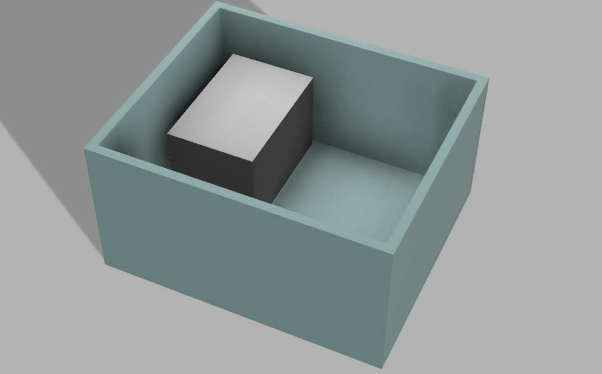

Figure Basic enclosure model with 15mm thick walls. The grey box inside models the dimensions of the LiFePO4 battery from earlier.

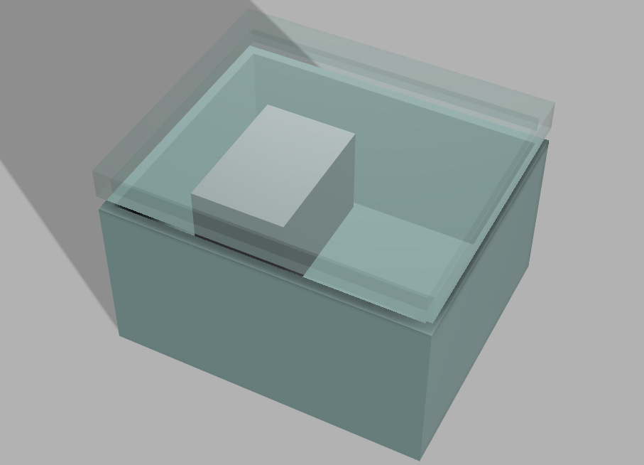

Figure Same basic enclosure model with transparent lid shown.

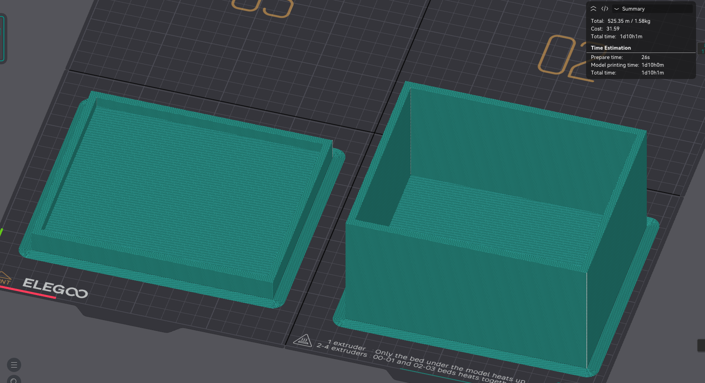

Figure Basic enclosure lid and body sliced in the software Orcaslicer to estimate material usage for this size of product.

**Potential solutions for the source of renewable energy:**

Team 11 has chosen to pursue solar as the choice of renewable energy due to higher efficiency, reliability, and portability. Out of the options for renewable energy the only feasible choices would be solar, hydroelectric, and wind power. Wind power would rely on the wind to be consistent and portable. There do exist several turbines with a large output such as a 500-watt turbine, however the turbines must be mounted too high in the air for it to be consistently portable, and the wind is too unreliable for the power output to be consistent enough for use. One such product is the VEVOR 800W 12V Wind Turbine Generator \[10\] which requires the turbine to be mounted between twenty and thirty feet in the air. There also exist water turbines that take flowing water and turn a turbine to generate power. These water turbines are too large, their output is not high enough, and to generate any power it requires being near a moving source of water which is too situational for the intended product use. One example of these water turbine generators is the VNATWGOO 100W Water Turbine Generator \[11\] which requires a constant flow of water and the output is too low for the higher price of the product which sits at \$250 for only one hundred watts. The best choice in terms of renewable would be to use solar panels but there are several kinds of panels which poses more options to choose from. The most common and easiest to find panels are the kinds that are intended for home use but those panels, while being significantly cheaper than most other panels, are also much larger and too large for use on a project that is intended to be easily portable. One of the many solar panel options is the Lumina SolarSpace 405W Monofacial Solar Panel \[12\] which has more than enough wattage to support the generator, but the panel is nearly four feet by 7 feet and weighs almost fifty pounds alone making it too large for the product to be reasonably portable. The best choice out of these options is to opt for a portable solar panel which is small enough to meet the product needs while also having enough power output to be a viable option for the generator. The issue with solar panels of this size is they tend to run at a higher price than most other options, however, due to them fitting the product needs the best the price is not the most important factor in consideration.

**Potential Solutions for the inverter:**

In order to produce the most efficient AC power while maintaining low costs and size, the best choice for an inverter is to use a pure sine wave inverter. A pure sine wave inverter produces the most efficient AC waveform and is typically the most compatible with smaller electronics as it is closer to the waveforms used by modern utilities. In addition to being the most efficient, a pure sine wave inverter produces less heat and stress on the equipment which is essential in an enclosed device such as a generator where heat is a large concern. \[24\] Other possible options for the inverter would be a square wave inverter or a modified sine wave inverter. Square wave inverters are the cheapest types of inverters; however they produce simple square waves by turning a switch on and off at a set interval. Square wave generators are suitable for rudimentary applications such as power tools but can damage more advanced and sensitive devices. \[25\] The last option that would be suitable for use in a portable generator is a modified sine wave generator which uses a series of square waves at varying amplitudes to replicate a true sine wave. These inverters are more efficient than a square wave inverter which is the least efficient, but the flat voltage levels used to replicate sine waves can harm electronics in a similar way to square wave inverter. \[26\] Due to the efficiency, cost, safety for electronics, and safety for consistent use, a pure sine wave inverter would be the best choice for use in the generator that team 11 is developing.

**Potential Solutions for the ac to dc adapter:**

In order to convert the AC voltage from the inverter into usable DC voltage for the integrated DC power supply there must be a system in place which could come from various means. The simplest and most cost-effective method to accomplish this would be to use a basic computer charger converter which would be straightforward, easy to implement, and cheap. The only other feasible option is to use a custom-made rectifier to convert the voltage with the desired ripple, however this option would be more costly, time consuming, and difficult than the precious method. Given these reasons, the best option for converting the AC voltage into DC for the power supply is to use a basic computer power converter that meets the required specifications of the project.

**Potential of solutions for the Embedded subsystem:**

To produce an image on the output display, some manner of computer is required. Immediately this presents some options that need to be narrowed down from. At the low-end an 8-bit microcontroller is to be technically able to drive a simple LCD or segment-based screen. On the high end, a full System on Chip (SoC) like a Raspberry Pi 3A is more than enough to drive the display and handle the controls. In between lies a more modest microcontroller chip such as the rp2040, rp2350, or esp32. A 32bit microcontroller is plenty to handle the screen, controls, and any GPIO needed to communicate to the rest of the system. If a custom PCB is required, the cost of a microcontroller is a magnitude less than a full SoC such as the Raspberry Pi 3A. So currently Team 11 will move forward assuming a 32-bit microcontroller is going to be the core of the embedded subsystem.

USB Type C power delivery (USB PD) is a standard set by the USB-IF for negotiation of power delivery through the Type-C USB port. Team 11 shall either find a commercially available board to handle the pd or integrate an IC such as the Texas Instruments TPS25772 that handles USB PD negotiation \[22\].

If a custom inverter is determined to be ideal, the inverter shall be given its own PCB to isolate the high voltage output from the low voltage microcontroller.

High-Level Solution:

Taking the formulated problem, survey of existing solutions, and comparative survey of potential solutions, Team 11 defines the High-Level solution as the Renewable Energy Generator. There shall be a portable central unit containing the systems and components that handle charging, discharging, storage of energy, and the controllable display. There shall be at least one separate solar unit that connects to the central unit to provide the source of renewable energy. Team 11 has broken the project into four subsystems listed below with a brief description. The inputs, outputs, interconnections, and specifications of each subsystem are described further in this section of the report.  
 **The Enclosure Subsystem**: An enclosure shall be designed to house the Power Subsystem and the Embedded Subsystem. It shall meet the portability and water resistance specifications defined in the earlier section Specifications and Constraints.  
**The Embedded Subsystem:** A PCB shall be designed to control an outward facing status display and shall serve as the human input device for all user controllable aspects of the device.  
**The Solar Subsystem:** A portable photoelectric solar panel device shall be designed to provide renewable energy to the central unit.  
**The Power Subsystem:** A battery shall be chosen and integrated with the appropriate systems to charge the battery from 120 V AC and the renewable energy source. These systems allow the battery to discharge to 120 V AC, an adjustable DC output, and a small selection of common USB ports.  
 

Hardware Block Diagram:

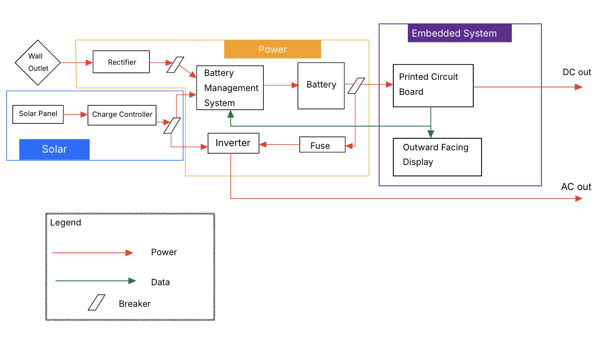

Figure Hardware block diagram showing power and data interconnects between key components

Operational Flow Charts:

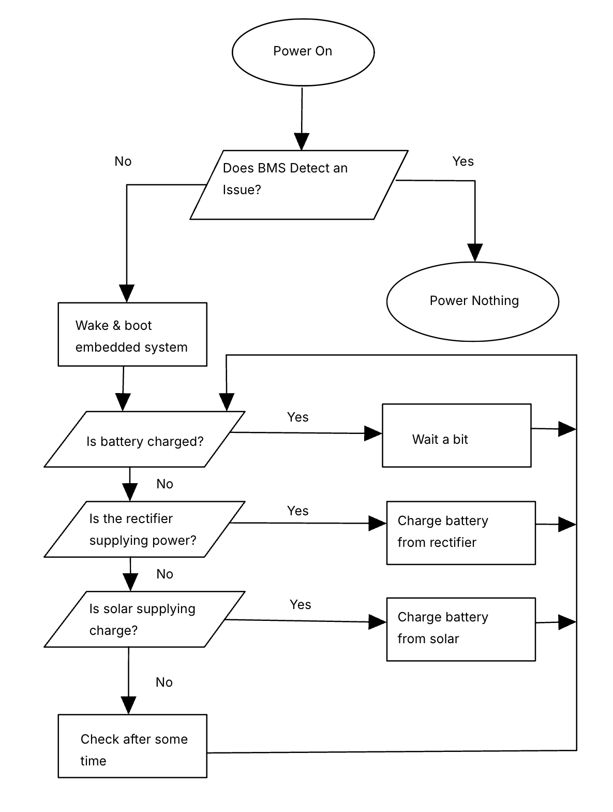

Figure Battery charging flow chart

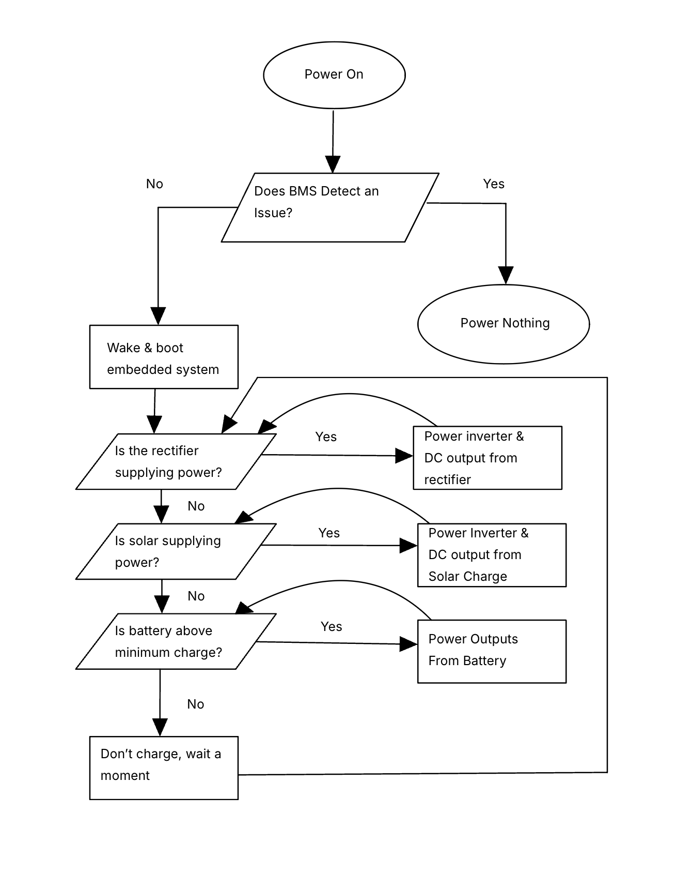

Figure Output source selection flow chart

**Solar:**

The solar panel system shall consist of either one foldable panel which supplies 200 watts or multiple smaller panels which supply fewer watts that add up to a total of 200 watts. The two main options for these panels consist of a 200-watt N-type foldable panel or two 100-watt bifacial solar panels which can both be connected to the generator in order to supply the appropriate amount of power. The panels of choice shall connect to the generator with a standard MC4 port which is the standard connection in photovoltaic systems and is used to connect solar panels and charge controllers while being weatherproof and secure against improper connections. \[23\] The panels shall connect to the charge controller with the MC4 connections which will then go to the battery or the load depending on what the need is at that moment.

The solar panels shall be free from the enclosure in a way that they can be freely moved around in order to achieve the optimal amount of sunlight. There shall be a stand that holds the panels so they can be raised higher into the air and pointed in different directions in order to maintain constant power supply from the sunlight regardless of where the sun is. The panels shall also be able to be stored in a manner that is easily portable along with the rest of the generator to maintain simplicity and be moved along with it.

**Power:**

The rectifier shall connect to AC power from the wall outlet to be one of the sources to provide DC power to the battery. The battery shall consist of the chemical makeup of lithium iron phosphate (LiFePO4). The battery shall be a wired connection to the battery management system (BMS) for output and input protection as "the battery management system ensures that each cell within a battery pack is kept within safe voltage limits." \[3\] The battery shall connect to a fuse through wire to the inverter for DC to AC conversion. The battery shall be able to be charged by either the rectifier or the solar charger. The rectifier shall be prioritized over the solar charger for charging the battery and providing power to the inverter and DC outputs.

The power system shall work in conjucture with the embedded system to provide smooth transi

**Enclosure and Frame:**

The enclosure shall provide structural support, physical protection, and environmental resistance for all internal components of the Renewable Energy Generator. The enclosure shall accommodate the battery management system (BMS) battery, inverter, cooling equipment, embedded display, electrical outlets, wiring, and associated mounting objects. The enclosure shall allow the generator to remain at or below Team 11's weight limit of 50 Ibs. The enclosure shall also support the generator's portability and outdoor use while remaining within the \$125 enclosure budget.

**Embedded:**

The embedded system consists of the display, controls, the primary PCB, and any secondary or tertiary PCBs that may be determined necessary later in development. The embedded system is responsible for the status of the device, and allowing the user to navigate a menu to control the device as needed. The embedded system also includes the variable DC power supply, USB Type-C power delivery (USB PD) negotiation, USB Type-A dedicated charging port (DCP) for 5V 1.5A, and potentially the inverter if a custom solution is deemed appropriate over a commercial inverter.

The primary PCB shall house the microcontroller either directly or as an expansion board for an existing development board. The display and any daughter boards shall be connected to the primary PCB. This PCB will be designed by the team and ordered from a PCB manufacturer.

The variable power supply shall output 0-24V variable DC up to at least 1.5A. The voltage shall be controlled either with an analog knob or digitally by the microcontroller. The terminals of the power supply shall be female receptacles for 4mm banana plugs commonly used for benchtop DC power supplies.

Measures of Success:

Measures of success would include meeting all the requirements laid out before and describing methods to test them to ensure that the project meets or exceeds the goals.

The generator will be tested on:

- Run time by running it at a specific load and ensuring that it runs for a minimum of two hours.
- Consistent power delivery by ensuring it operates with an uninterrupted supply by changing the power source and ensuring the change between sources is seamless.
- Portability by ensuring that it meets the team's weight standards of being no higher than fifty pounds and has a means of simple transportation.
- Weather resistance by means of spraying the case with water and testing the water contents of the inside of the case to see the resistance rating.
- Affordability by comparing the cost of the project to ensure that it is no more than the maximum budget that team sets for the whole project, with the goal being to spend less than the closest competitor on the market.
- Usability by ensuring that the integrated display is readable, shows the battery level, shows the voltage levels, as well as any other decided upon information.

| Test:                        | Minimal Success                                                                                                                                                                                       | Good Success                                                                                                                                                                      | Great Success                                                                                                                                             |
| ---------------------------- | ----------------------------------------------------------------------------------------------------------------------------------------------------------------------------------------------------- | --------------------------------------------------------------------------------------------------------------------------------------------------------------------------------- | --------------------------------------------------------------------------------------------------------------------------------------------------------- |
| Run Time at 200W             | Two hours                                                                                                                                                                                             | Four hours                                                                                                                                                                        | Eight hours                                                                                                                                               |
| Consistent Power Delivery    | Users might notice small interruptions when power management system swaps sources. Devices might recognize loss of power. But the process is still automatic and doesn't require manual intervention. | Users don't notice interruptions when power management system swaps sources. Devices might recognize loss of power. Process is automatic and doesn't require manual intervention. | Users don't notice interruptions nor do most devices detect power loss during source swaps. Process is automatic and doesn't require manual intervention. |
| Max average load on battery. | 200W continuously                                                                                                                                                                                     | 400W continuously                                                                                                                                                                 | 600W  continuously                                                                                                                                  |
| Central Unit Weight Target   | Central unit weighs less than 50 lbs.                                                                                                                                                                 | Central unit weighs less than 40 lbs.                                                                                                                                             | Central unit weighs less than 35 lbs.                                                                                                                     |
| Handling and maneuverability | Central unit has wheels and a handle. Handling may not be comfortable but is possible.                                                                                                                | Central unit has wheels and a handle that make it easy to transport on flat surfaces.                                                                                             | Central unit has durable wheels and a handle that make it easy to transport on flat surfaces and grass                                                    |
| Water Resistance             | Central unit is safe to be rained on momentarily. Long enough to remove device from environment under constant supervision.                                                                           | Central unit is safe to be rained on for short period of time. Longer than required by constant supervision.                                                                      | Central unit is safe to operate in constant rainfall while output ports are sealed or covered.                                                            |
| Affordability                | Project is able to be built for less than \$1000                                                                                                                                                      | Project is able to be built for less than \$900                                                                                                                                   | Project is able to be built for less than \$800                                                                                                           |
| Usability                    | Display is legible and contains pertinent information about battery health. Controls are functional.                                                                                                  | Display is pleasant, contains pertinent and additional information about sources and loads. Controls are functional.                                                              | Display is pleasant, contains pertinent and additional information about sources, loads, and more. Controls are functional and intuitive.                 |

Resources:

To properly allocate resources for the success of the project, the budget for key components has been listed below and the estimated kinds of labor has been divided among members. A Gantt chart with Team 11's past and current work is included.

Budget:

| **Subsystem**       | **Estimate** |
| ------------------- | ------------ |
| Battery             | \$300        |
| BMS                 | \$100        |
| Solar Panel(s)      | \$250        |
| Embedded System     | \$125        |
| Enclosure and Frame | \$125        |
| Total:              | \$850        |

Division of Labor:

Required Skills:

Software & Programming - C Programming

Hardware & Systems - Embedded Systems Power Systems

Design & Simulation – KiCAD CAD / 3D Printing

Theory & Analysis – Power System Analysis

Team Member Skills:

Miles Bolden

- Current Skill: LTSpice, Power System Analysis, C++, Onshape
- Skills to Learn: KiCAD, Autodesk Fusion

Bryce Coln

- Current Skills: Power System Analysis, LTSpice, C++
- Skills to Learn: KiCAD, Autodesk Fusion, 3D Printing, Control System Analysis

Justin Egwuatu

- Current skills: Power System Analysis, SolidWorks, LT Spice
- Skills to learn: KiCAD, Autodesk Fusion, 3D Printing, Control System Analysis

Tobin McGee

- Current skills: Autodesk Fusion, C, C++, Assembly, LT Spice, FDM additive manufacturing
- Skills to learn: KiCad, Git

Supervisor & Instructor:

Professor Storm: Has experience in similar projects, being able to provide guidance on certain systems or subsystems. Storm will provide the expectations of the project before finalization. Point of contact for our emulated customer.

Timeline:

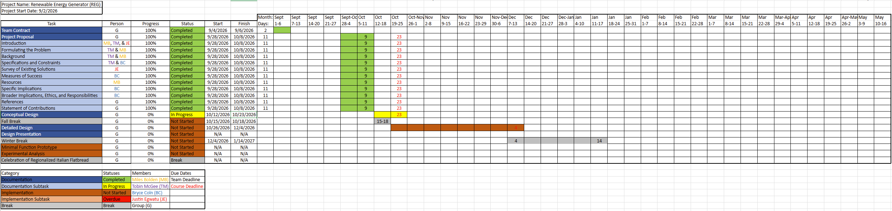

Specific Implications:

This project will provide an immediate solution to the customer's problem of having reliable and easily accessible power while hosting events or working in areas where there is not a readily available power source. During events where there are displays and interactive demonstrations, there is a need for reliable power to maintain the different needs at the event and depending on where the events are held that could be difficult to find. With the renewable energy generator, it will provide a power source to alleviate that needs through solar power or the pre-charged internal battery. This will enable events to go smoother, allowing for less trouble for the organizers and other people that may be in attendance.

Ethical, Professional, and Standards Considerations:

Outside of the specific customer needs for this project, this generator could provide benefits to other people throughout the country and across the globe with various needs. The generator could assist those going through natural disasters or other such events in which they experience power outages. The generator is portable and can provide power to those in need in times of crisis to provide aid until further aid can be found.

Team 11 shall adhere to ethics and safety standards, making sure that the generator is safe for use by the customers, as well as safe for the public and the environment.

References: (WIP)

\[1\] "WEN - Shop Generators, Woodworking Tools, and Power Tools," _WEN Products_, 2026. <https://wenproducts.com/>

\[2\] "Jackery Best Solar Generator, Portable Power Station & Solar Panels," Jackery. <https://www.jackery.com>

\[3\] " Why Is a Battery Management System Important?" MathWorks. [https://www.mathworks.com](https://www.mathworks.com/discovery/battery-management-system.html)

\[4\] " S1200 Portable Power Station 1200W LiFePO4," UDPOWER [https://udpwr.com](https://udpwr.com/products/udpower-s1200-portable-power-station?variant=45431944544446&country=US&currency=USD&utm_medium=product_sync&utm_source=google&utm_content=sag_organic&utm_campaign=sag_organic&gad_source=1&gad_campaignid=23260955164&gbraid=0AAAAA-ZndfUrhSkDe3xWHK6v3D3z-aZiY&gclid=CjwKCAjwotzWBhBFEiwA1JhPoFfR025JivKW-e0SvSEP8Y1DwgsuEMlYGIcbuHIcTzUFyISqy7QCBhoCDwEQAvD_BwE)

\[5\] " EcoFlow - Delta 3 Classic Portable Power Station," [https://www.bestbuy.com](https://www.bestbuy.com/product/ecoflow-delta-3-classic-portable-power-station-1024wh-with-45w-solar-panel-protective-bag1800w-ac-output-for-home-backup-1024-wh-capacity-light-gray/JJGTTGFRTG/sku/12644211?ref=212&loc=Marketplace_23051108603&gclsrc=aw.ds&gad_source=1&gad_campaignid=23055140101&gbraid=0AAAAAD-ORIiIGd1DIG4BAo8hF7carNeMy&gclid=CjwKCAjwotzWBhBFEiwA1JhPoAEScn4ANCBnSuEy9gUH52OgYJnzRYQS4EcwpdSAo9OlDZxEHPpEGRoCl-wQAvD_BwE)

\[6\] "The Benefits of LiFePO4 Batteries in Portable Power Stations," DuroMax.

[https://www.duromaxpower.com](https://www.duromaxpower.com/blogs/news/the-benefits-of-lifepo4-batteries-in-portable-power-stations?srsltid=AU7gw4VKGlgnzzSFUJyBDE8UXDJLwgQ636_UyJgRGzCQwStZJpN7fB0P)

\[7\] "Harbor Freight Tools," _Harbor Freight Tools_, 2025.

<https://www.harborfreight.com/5800-weatherproof-protective-rolling-carry-on-case-x-large-64819.html>

\[8\] National Fire Protection Association "NFPA Link®," _Nfpa.org_, (2025).

<https://link.nfpa.org/free-access/publications/70/2023?callback_url=%2Ffree-access%2Fpublications%2F70%2F2023> \[Accessed Oct. 21, 2026\].

\[9\] National Fire Protection Association "NFPA Link®," _Nfpa.org_, (2025).

<https://link.nfpa.org/free-access/publications/70/2023?callback_url=%2Ffree-access%2Fpublications%2F70%2F2023> \[Accessed Oct. 21, 2026\].

\[10\] VEVOR, "800W 12V wind turbine generator, 5-blade wind turbine kit with MPPT controller," Amazon. \[Online\]. Available: [https://www.amazon.com/dp/B0H6QXQPJ6](https://www.amazon.com/dp/B0H6QXQPJ6?utm_source=chatgpt.com). \[Accessed: Oct. 25, 2026\]

\[11\] VNATWGOO, "100W water turbine generator, micro hydro generator, low-speed water wheel hydroelectric," Amazon. \[Online\]. Available: [https://www.amazon.com/dp/B0DWMXB2SW](https://www.amazon.com/dp/B0DWMXB2SW?utm_source=chatgpt.com). \[Accessed: Oct. 25, 2026\].

\[12\] Signature Solar, "Lumina SolarSpace 405W monofacial solar panel," Signature Solar. \[Online\]. Available: [https://signaturesolar.com/lumina-solarspace-405w-monofacial-solar-panel/](https://signaturesolar.com/lumina-solarspace-405w-monofacial-solar-panel/?utm_source=chatgpt.com). \[Accessed: Oct. 25, 2026\].

\[13\] Inverters, Converters, Controllers and Interconnection System Equipment for Use With Distributed Energy Resources, UL 1741, 3rd ed., UL Standards & Engagement, 2021.

\[14\] "ZEUS Battery Products PCLFP10-12.8F2," _DigiKey Electronics_, 2026. [https://www.digikey.com](https://www.digikey.com/en/products/detail/zeus-battery-products/PCLFP10-12-8F2/9828820) (accessed Oct. 23, 2026).

\[15\] "Power-Sonic Super Sport PTX12BS-FS SLA Battery | Battery Junction," _Battery Junction_, Oct. 12, 2026. <https://www.batteryjunction.com/products/powersonic-ptx12bs-fs> (accessed Oct. 23, 2026).

\[16\] <https://www.usb.org/document-library/usb-power-delivery>

\[17\] <https://www.cdc.gov/niosh/publications/numbered/94-110.html>

\[18\] <https://www.ecfr.gov/current/title-47/chapter-I/subchapter-A/part-15>

\[21\] <https://shop.polymaker.com/products/polylite-abs?variant=40314305380409>

\[22\] <https://www.ti.com/product/TPS25772-Q1>

\[23\] BLUETTI Team, "MC4 connector: What is it and how do you connect?," BLUETTI, Oct. 15, 2026. \[Online\]. Available: [https://www.bluettipower.com/blogs/articles/mc4-connector-what-is-it-and-how-do-you-connect](https://www.bluettipower.com/blogs/articles/mc4-connector-what-is-it-and-how-do-you-connect?utm_source=chatgpt.com). \[Accessed: Oct. 25, 2026\].

\[24\] AnandKumar, "What is a sine wave inverter?," Electrical Curiosity. \[Online\]. Available: [https://electricalcuriosity.com/what-is-sine-wave-inverter/](https://electricalcuriosity.com/what-is-sine-wave-inverter/?utm_source=chatgpt.com). \[Accessed: Oct. 25, 2026\].

\[25\] Matan, "Square wave inverter," Electricity – Magnetism, Oct. 26, 2023. \[Online\]. Available: [https://www.electricity-magnetism.org/square-wave-inverter/](https://www.electricity-magnetism.org/square-wave-inverter/?utm_source=chatgpt.com). \[Accessed: Oct. 25, 2026\].

\[26\] Matan, "Modified sine wave inverter," Electricity – Magnetism, Oct. 26, 2023. \[Online\]. Available: [https://www.electricity-magnetism.org/modified-sine-wave-inverter/](https://www.electricity-magnetism.org/modified-sine-wave-inverter/?utm_source=chatgpt.com). \[Accessed: Oct. 25, 2026\].

Statement of Contributions: (WIP)

Miles Bolden: Introduction, Background, Timeline

Bryce Coln: Specifications and Constraints, Specific Contributions, Broader Implications, ethics, and Responsibilities as Engineers, Measures of Success

Justin Eguawtu: Introduction, Existing Survey of Solutions

Tobin McGee: Defining the Problem and general curation of the document.